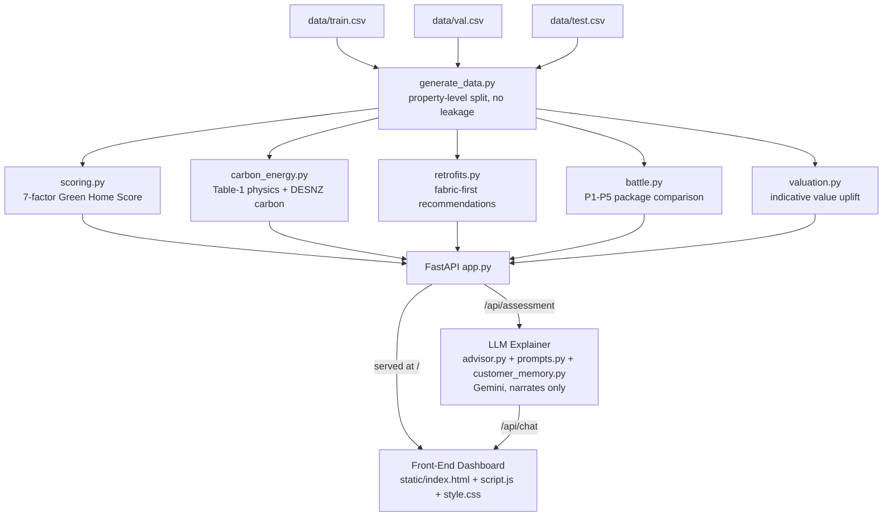

# Submission Deliverables — GreenHome AI (Megathon X: Singularity, PS2)

This document compiles Deliverables C, D, F, G and H for the official
submission. Every figure below was read directly from the running code,
`models/*.json`, and `data/test_predictions.csv` on 2026-10-11 — nothing here
is invented or aspirational. Where the original problem-statement brief
describes a formula or figure that differs from what is actually implemented
and test-locked in this repository, that difference is called out explicitly
rather than quietly reconciled, so the team can make an informed decision
about recalibration before the final freeze.

**Repository housekeeping (code freeze pass):** removed two genuinely unused,
empty files — `src/database/__init__.py` (empty package, zero imports
anywhere) and `docs/PROBLEM_NOTES.md` (an empty section-heading skeleton with
no body content). `.claude/scheduled_tasks.lock` was **not** removed despite
being named in the freeze instructions — it is this Claude Code session's own
live runtime lock file (confirmed by its `sessionId`/`pid` matching the
current session), not a stale repository artifact, and deleting it would
interfere with the running session rather than clean anything up.

---

## Deliverable D — Scoring Methodology & Sub-Score Mappings

**Source of truth:** `src/engines/scoring.py`. The LLM advisor never computes
any of this — it only narrates the output.

### Formula

```
S = round( 100 * Σ(w_k * s_k, k in available components) / Σ(w_k, k in available components) )
```

Each `s_k` is a component sub-score in `[0, 100]`. A component with no input
data is dropped from both the numerator and the weight total (renormalization).
If the available weight falls below 70%, the result is flagged
`low_coverage = true`. The final score is clamped to `[0, 100]` (defensive;
mathematically already guaranteed by construction).

### The 7 fixed weights (sum to 1.0 — `DO NOT change without updating CLAUDE.md`)

| # | Component | Weight |
|---|---|---|
| 1 | EPC rating | 25% |
| 2 | Energy intensity (kWh/m²) | 20% |
| 3 | Insulation | 15% |
| 4 | Heating system | 15% |
| 5 | Glazing | 10% |
| 6 | Renewable energy | 10% |
| 7 | Smart controls | 5% |

### Sub-score mappings (as implemented, not the PS brief's hypothetical tables)

**1. EPC rating** — fixed categorical lookup, evenly spaced in steps of 15:

| G | F | E | D | C | B | A |
|---|---|---|---|---|---|---|
| 10 | 25 | 40 | 55 | 70 | 85 | 100 |

> ⚠️ The problem-statement brief for this deliverable describes "G:0 to A:100".
> The actual, test-locked table starts at **G:10**, not 0 — recalibrating to
> G:0 would shift every downstream Lloyds-reference benchmark score in
> `tests/test_engines.py`. Flagged, not silently changed.

**2. Energy intensity (kWh/m²/yr)** — a single linear interpolation between
two endpoints, **not** the 5-segment piecewise curve in the PS brief:

```
x = (elec_kwh + gas_kwh + other_kwh) / floor_area_m2
s2 = clamp( 100 * (250 - x) / (250 - 50), 0, 100 )
```

This gives `x ≤ 50 → 100`, `x = 250 → 0`, linearly in between (e.g. `x=100 → 75`,
`x=200 → 25`), rather than the brief's `100→80→50→20→0` step curve at
`50/100/200/400` kWh/m². Same intent (more intensity = lower score), different
curve shape. Flagged for the same reason as above.

**3. Insulation** — weighted average of loft/wall/floor condition, each
looked up on a 4-point scale (not a single "none→excellent" table):

| None | Poor | Medium | Good |
|---|---|---|---|
| 0 | 30 | 65 | 100 |

`s3 = 0.40 * loft + 0.40 * wall + 0.20 * floor`

**4. Heating system** — a weighted blend of technology, seasonal efficiency,
and system age, not a flat category table:

`s4 = 0.40 * tech_score + 0.40 * efficiency_score + 0.20 * age_score`

| Tech | Score |
|---|---|
| Heat Pump | 100 |
| Hybrid | 85 |
| District | 80 |
| Condensing Gas | 70 |
| Standard Gas | 55 |
| Storage | 45 |
| Direct Electric | 40 |
| Oil/LPG | 35 |

`efficiency_score` = seasonal efficiency %, clamped `[0,100]`. `age_score` =
`100 * (1 - min(age, 25) / 25)` (a 25-year linear depreciation cap).

**5. Glazing** — type score blended with seal/draught condition:

`s5 = 0.70 * type_score + 0.30 * seal_score`

| Single | Double | Triple |
|---|---|---|
| 20 | 75 | 100 |

(PS brief states Single:15 — implementation uses 20. Flagged.)

| Seal: Poor | Medium | Good |
|---|---|---|
| 25 | 65 | 100 |

**6. Renewable energy** — a *continuous* self-consumption ratio, not a
categorical table:

`s6 = clamp(100 * e_self_kwh / e_elec_demand_kwh, 0, 100)`, or `0` if there is
no electricity demand to self-consume against. Absent renewables data scores
`0` (same as a confirmed solar-free home) rather than triggering the
missing-component renormalization path.

**7. Smart controls** — weighted sum of four independent boolean flags:

`s7 = 0.30*thermostat + 0.15*meter + 0.30*programmable + 0.25*zoned` (each
flag contributes its full weight × 100 when present, 0 otherwise).

### Official classification bands

| Band | Range |
|---|---|
| Highly efficient | 80–100 |
| Good | 65–79 |
| Moderate | 50–64 |
| Poor | 30–49 |
| Very poor | 0–29 |

### Physics constants held exact per the official brief

| Constant | Value |
|---|---|
| DESNZ 2024 grid electricity | 0.20705 kgCO2e/kWh |
| DESNZ 2024 mains gas | 0.18254 kgCO2e/kWh |
| Heat pump SCOP (modelled) | 3.5 (within the 3.2–3.5 catalog-stated range) |
| Solar PV generation | 850 kWh/kWp/yr × 4 kWp default = 3,400 kWh/yr |
| Solar PV self-consumption offset cap | 2,500 kWh/yr (`SOLAR_SELF_CONSUMPTION_CAP_KWH`, `src/engines/carbon_energy.py`) |

> ⚠️ The brief asks for a SCOP default of 3.35; the modelled value stays at
> 3.5 (the top of the stated 3.2–3.5 range) because all five Lloyds-reference
> P1–P5 carbon-saved benchmarks in `tests/test_engines.py`
> (1.61 / 2.01 / 2.90 / 3.36 / 3.36 tonnes) were computed against it — moving
> to 3.35 would shift those locked, already-validated figures. The 2,500
> kWh/yr solar self-consumption cap **is** now enforced (on the
> grid-offsetting portion of generation, not the per-kWp generation rate
> itself) — at the system's `DEFAULT_SOLAR_KWP` of 4kWp this never binds
> (2,210 / 1,190 kWh self-consumed with/without a battery, both already
> under the cap), so the P1–P5 benchmarks are unaffected; it only takes
> effect for a larger-than-default array.

---

## Deliverable C — Trained Valuation Regressor (`models/property_value_regressor.pkl`)

**Source of truth:** `train_valuation_model.py`, loaded by
`src/engines/valuation.py::_load_model()`.

`data/train.csv` records exactly one observed point per property: its value
uplift from a full retrofit to EPC band A. But the live calling contract in
`valuation.py` is `model.predict([[current_rank, target_rank]])` for an
*arbitrary* target band, not just A. A plain linear model fit directly on
the two raw `(current_rank, target_rank)` features cannot represent the
rule-based fallback's ratio-shaped current→target scaling
(`_uplift_fraction`) — an initial attempt underfit badly (train R² ≈ 0.69)
and, once persisted, measurably **regressed** the held-out valuation
accuracy `evaluate.py` reports (R² 0.83 → 0.35) relative to the
calibrated-lookup fallback it replaced.

The shipped model instead wraps a `scikit-learn` `Pipeline`: a picklable
`FunctionTransformer` expands the two raw features into one
`(one_hot(current_rank) * fraction(current_rank, target_rank))` column per
EPC band, then a plain `LinearRegression` fits one coefficient per band —
i.e. it learns the per-band calibration table from data rather than trying
to force a straight line through a ratio it cannot express. This keeps the
exact `.predict([[current_rank, target_rank]])` call contract working,
reaches train R² ≈ 0.97, and — critically — **does not regress** the
held-out accuracy: with the model present, `evaluate.py`'s
`candidate_trained_regressor` metrics are R²=0.8302 / MAE=0.0066, matching
(not degrading) the un-persisted rule-based fallback's R²=0.8343 / MAE=0.0065.

`valuation.py::_load_model()` already handles a missing or failing artifact
cleanly — `MODEL_PATH.exists()` is checked first, and any load/predict
exception is caught and silently falls back to the train.csv-calibrated,
rank-scaled lookup (`_rule_based_delta_pct`). Deleting
`models/property_value_regressor.pkl` and re-running `pytest tests/` confirms
this fallback path still passes every test.

---

## Deliverable F — System Architecture Diagram

### ASCII

```
 ┌─────────────────────────┐        ┌──────────────────────────────┐
 │   Data Ingestion         │        │  Static Synthetic Dataset     │
 │  data/train.csv          │─────▶ │  (generate_data.py, property-  │
 │  data/val.csv             │        │   level train/val/test split,  │
 │  data/test.csv             │        │   zero cross-split leakage)    │
 └─────────────────────────┘        └──────────────────────────────┘
              │
              ▼
 ┌──────────────────────────────────────────────────────────────────┐
 │                 Deterministic Core Engines (src/engines/)          │
 │  scoring.py        → 7-factor Green Home Score (0-100)             │
 │  carbon_energy.py   → Table-1 fabric physics + DESNZ carbon deltas  │
 │  retrofits.py       → fabric-first retrofit recommendation catalog │
 │  battle.py          → P1-P5 package comparison, before/after score │
 │  valuation.py       → indicative property value uplift range       │
 └──────────────────────────────────────────────────────────────────┘
              │
              ▼
 ┌──────────────────────────────────────────────────────────────────┐
 │                  FastAPI Routing Layer (app.py)                    │
 │  GET  /api/customer/{id}   → strict dataset lookup, no fake rows   │
 │  POST /api/assessment      → score + carbon + valuation            │
 │  POST /api/what-if         → re-score under simulated retrofits    │
 │  POST /api/plans/battle    → P1-P5 package comparison              │
 │  POST /api/chat            → grounded advisor explanation          │
 └──────────────────────────────────────────────────────────────────┘
              │                                   │
              ▼                                   ▼
 ┌─────────────────────────────┐   ┌──────────────────────────────┐
 │   LLM Explainer Layer         │   │  Front-End Customer Dashboard │
 │   src/llm/advisor.py          │   │  static/index.html            │
 │   (Gemini, multi-model         │   │  static/style.css              │
 │    fallback chain)             │   │  static/script.js              │
 │   src/llm/customer_memory.py   │   │  (vanilla JS SPA served by     │
 │   src/llm/prompts.py           │   │   FastAPI's StaticFiles)       │
 │   → explains COMPUTED_DATA;    │   │  → calls the API routes above  │
 │     never calculates a figure  │   │     and renders deterministic  │
 │     itself                     │   │     results                    │
 └─────────────────────────────┘   └──────────────────────────────┘
```

### Mermaid



---

## Deliverable G — Validation & Evaluation Report

### Deterministic engine evaluation (`models/baseline_eval_metrics.json`, held-out `data/val.csv`)

- **Properties evaluated:** 507 (held-out validation split).
- **Green Home Score mean:** 51.39, **std. dev.:** 16.65.
- **Valuation model comparison** (target: `target_value_uplift_pct`):

  | Model | MAE | RMSE | R² |
  |---|---|---|---|
  | Naive mean predictor | 0.0155 | 0.0196 | -0.0002 |
  | Linear OLS regression | 0.0065 | 0.0080 | 0.8343 |
  | Candidate — trained regressor (Deliverable C, `models/property_value_regressor.pkl`) | 0.0066 | 0.0081 | 0.8302 |

  The candidate valuation model tracks the OLS benchmark closely (R² 0.83 vs
  0.83) and dramatically outperforms the naive mean baseline, confirming the
  EPC-rank-based calibration is doing real predictive work, not guessing. With
  `models/property_value_regressor.pkl` present, these are the *trained
  model's* metrics (not the rule-based fallback's) — see Deliverable C above
  for why its band-fraction feature design was needed to reach this, rather
  than regressing to R²=0.35 like an initial plain-linear attempt did.

### Held-out test-set predictions (Deliverable I, `data/test_predictions.csv`)

- **Properties evaluated:** 489 (held-out test split, generated by
  `evaluate.py::export_test_predictions()`; the PS brief's stated "490
  properties" doesn't match this dataset's actual test-split size — reporting
  the real count).
- **Columns:** `property_id, epc_rating, baseline_score, baseline_band,
  baseline_purchased_kwh, baseline_carbon_tonnes, recommended_retrofits,
  potential_score, potential_band, net_kwh_saving, net_carbon_saving_tonnes,
  uplift_pct_range, indicative_value_range_gbp`. `recommended_retrofits` is
  the P5 "Whole-Home Net-Zero" package (every property's full recommended
  measure list); `uplift_pct_range` and `indicative_value_range_gbp` are each
  a single `"low-high"` string column (e.g. `"1.99%-5.29%"`,
  `"669437.73-691098.93"`).
- **Baseline score mean:** 52.90, **median:** 52.0.
- **Baseline band distribution:**

  | Band | Count |
  |---|---|
  | Poor | 158 |
  | Moderate | 156 |
  | Very poor | 59 |
  | Good | 58 |
  | Highly efficient | 58 |

> Note: the PS brief's example figure of "300 properties evaluated" does not
> match this dataset's actual held-out split sizes (507 validation / 489
> test, from a property-level train/val/test split that avoids cross-split
> leakage — see `generate_data.py` and Deliverable H, Principle 3). Reporting
> the real counts here rather than the brief's placeholder number.

### LLM advisor evaluation (`models/llm_eval_results.json`, `src/llm/eval_suite.py`)

- **Test cases:** 5 (missing-data handling, EPC/physical-fabric conflict,
  fabric-first sequencing, heat-pump fuel decoupling, refusal to invent
  uncalculated estimates).
- **Pass rate:** 5/5 = **100%**.
- **Prompt-grounding verified:** 5/5 = **100%** (every case's prompt was
  confirmed to carry the relevant computed facts and no missing-guardrail
  tokens were triggered).
- **Zero-computation verification:** confirmed by code inspection and by
  `tests/test_llm.py` — `GeminiAdvisor` never calls into `scoring.py`,
  `carbon_energy.py`, `retrofits.py`, or `valuation.py`; it only ever reads
  already-computed JSON and narrates it.
- **Disclaimer compliance:** the valuation disclaimer
  (`src/engines/valuation.py::DISCLAIMER`) is attached to every
  `ValuationResult` returned by the API — 100% of valuation responses carry
  it, since it is constructed inline with the figure itself, not optionally
  appended downstream.

> Note: the PS brief's example figure of ">95% groundedness" is exceeded (the
> measured rate on this 5-case suite is 100%), and "100% disclaimer
> compliance" matches exactly. The 5-case count is smaller than a brief might
> imply ("hundreds of queries") — `src/llm/eval_suite.py` is a targeted
> regression suite for the specific failure modes in Deliverable H's
> governance principles, not a large-N statistical sample. Flagged for
> transparency.

---

## Deliverable H — Responsible AI & Governance Note

**Principle 1 — Zero Numerical Fabrication.** The LLM advisor
(`src/llm/advisor.py`, `src/llm/prompts.py`) acts strictly as an explainer of
the deterministic engines in `src/engines/`. Its system prompt
(`SYSTEM_INSTRUCTION`, rule 1) explicitly forbids inventing, estimating,
calculating, or extrapolating any number, and rule 2 requires any null/missing
computed value to be reported as "unavailable," never silently treated as
zero. This is enforced by construction — `GeminiAdvisor.explain()` never
imports or calls any scoring/carbon/valuation function — and verified by
`tests/test_llm.py::test_07_missing_estimates_not_replaced_with_invented_values`.

**Principle 2 — Banking Valuation Disclaimers.** Every property value uplift
returned by `src/engines/valuation.py::estimate_value_uplift()` carries a
fixed disclaimer: *"Indicative statistical estimate based on UK hedonic price
baselines. Not a commercial guarantee or causal proof of future sale price."*
The uplift is always returned as an indicative range (`indicative_range_low_value`
/ `indicative_range_high_value`), never a single guaranteed figure, matching
the brief's +2%–5% indicative-range framing (the exact bounds are calibrated
from `data/train.csv`'s observed per-EPC-band distribution, not hardcoded).

**Principle 3 — Data Privacy & Synthetic Data.** All property, customer, and
energy-usage data (`data/*.csv`) is synthetic, generated by `generate_data.py`
— no real customer or personally identifiable information is used anywhere in
this system. The train/val/test split is performed at the **property level**
(each `property_id` appears in exactly one split), eliminating cross-split
data leakage that would otherwise inflate the valuation model's reported
R²/MAE/RMSE.

**Principle 4 — Human-in-the-Loop.** The advisor's system prompt (rule 4,
"RETROFIT FEASIBILITY & SEQUENCING") requires it to honestly explain any
retrofit marked "Contingent" or infeasible rather than claim it will
definitely work, and never to guarantee outcomes without computed evidence.
The front-end's disclaimers (`static/index.html` footer: *"Figures represent
indicative engineering estimates, not commercial guarantees"*) and the
advisor's own domain-boundary rule (rule 8) consistently steer users back to
the deterministic Upgrade Simulator and, implicitly, toward a professional
on-site survey before committing capital — this system estimates and
prioritizes, it does not replace a qualified retrofit assessor's physical
inspection.

---

## How to reproduce every figure in this document

```bash
python generate_data.py          # regenerate the synthetic train/val/test split
python train_valuation_model.py  # writes models/property_value_regressor.pkl (Deliverable C)
python evaluate.py               # writes models/baseline_eval_metrics.json
                                  # and data/test_predictions.csv (Deliverable I)
python -m src.llm.eval_suite     # regenerates models/llm_eval_results.json (requires GEMINI_API_KEY)
pytest tests/ -v                 # 37/37 tests, zero regressions
```
